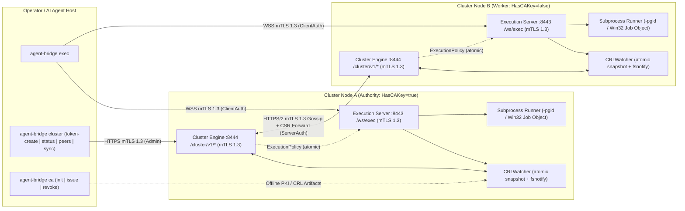

# Technical Specification: Agent-Bridge (`v0.1.1`)

`agent-bridge` is a single static Go binary (`CGO_ENABLED=0`) providing mutual-TLS 1.3 remote command execution over transactional WebSockets (`/ws/exec`), a built-in ECDSA P-256 Public Key Infrastructure (PKI) with hot-reloaded Certificate Revocation Lists (CRLs), and an optional decentralized TLS 1.3 multi-node cluster control plane (`/cluster/v1/*`) for cryptographic node enrollment, topology-aware quorum evaluation, and signed policy/CRL replication.

> [!NOTE]
> **Implementation & Target Infrastructure Validation Status (`v0.1.1`)**
> Phase 1–3 subsystems are implemented in Go `1.26.8`, verified across automated Linux `-race` suites and loopback multi-daemon sandboxes, and field-validated in standalone (`N=1`) mode on Windows Server 2022 (including Win32 Job Object child-tree termination, NTFS `icacls` DACLs, `80ms` live NTFS `crl.pem` hot-reload under Windows Defender, Scheduled Task boot/crash supervision, and cross-OS Debian 12 -> Windows Server 2022 mTLS 1.3 execution). Multi-node (`N >= 2`) cross-host Tailscale clustering remains pending multi-server field rollout (Section 1.1).

---

## 1. Implementation & Validation Status

### 1.1 Verification Matrix

| Verification Domain | Status | Evidence & Remaining Field Scope |
| :--- | :--- | :--- |
| **Static Cross-Compilation** | Verified in CI | `CGO_ENABLED=0 -trimpath -ldflags="-X main.version=v0.1.1"` produces standalone binaries (retaining symbol/DWARF sections to reduce heuristic AV ML false positives on unsigned builds) for `windows/amd64`, `linux/amd64`, `linux/arm64`, and `darwin/arm64`; `go vet ./...` clean across OS targets. |
| **Automated Race-Detector Suite** | Verified in CI | 64 top-level `go test -race` test suites passing across all 8 Go packages (`cluster`, `cmd/agent-bridge`, `internal/pki`, `internal/protocol`, `internal/runner`, `internal/server`, `internal/config`, `internal/client`). |
| **PKI, X.509v3 & RFC 5280 CRL** | Verified in CI & Windows Server | ECDSA P-256 Root CA, leaf profiles (`server`, `client`, `peer`), PKCS#10 CSR issuance, monotonic `CRLNumber` progression, OpenSSL X.509v3/CRL interoperability, and `CRLWatcher` hot-reload verified on Linux and Windows NTFS (`80ms` hot-reload). |
| **Execution Plane (`/ws/exec`)** | Verified Cross-OS (Linux & Windows Server 2022) | TLS 1.3 mTLS handshake, revoked-serial rejection, pre-upgrade `ExecutionPolicy` client ACLs, `10 MiB` per-stream caps (`exit 137`), timeout clamping (`exit 124`), client-disconnect cancellation, Unix `-pgid` `SIGKILL`, Win32 Job Object tree-kill, and Debian 12 -> Windows Server 2022 execution verified end-to-end. |
| **Multi-Node Cluster (`cluster/`)** | Verified on Linux Loopback | Single-node, 2-node deadlock-free failover, 3-node majority quorum and minority step-down, Mode A CSR join, Mode B pre-issued PoP join, non-CA CSR forwarding, signed policy anti-rollback, and live CRL peer expulsion verified across multi-daemon `127.0.0.1` meshes. |
| **Multi-Host Tailscale / WAN Mesh (`N >= 2`)** | **Pending Field Validation** | `1.5s` gossip cadence, `4.5s` suspect / `9.0s` unreachable thresholds, cross-host `:8444` cluster join, and asymmetric partition healing require multi-host Tailscale overlay testing. |

---

## 2. System & Repository Architecture

### 2.1 Core Architectural Invariants

1. **Minimal Dependency Footprint:** Built on the Go `1.26.8` standard library plus exactly three external modules (`fsnotify`, `gorilla/websocket`, `golang.org/x/sys`). Zero CGO, OpenSSL, Python, or external database/consensus dependencies.
2. **Token-Conserving Transactional Execution:** Each `agent-bridge exec` invocation opens one mTLS 1.3 WebSocket connection to `/ws/exec`, sends one `CommandRequest` JSON text frame, receives one `CommandResponse` JSON text frame with leading/trailing whitespace trimmed and empty streams omitted (`omitempty`), exchanges WebSocket `1000` (`CloseNormalClosure`), and exits with the remote command's exit code.
3. **Defense-in-Depth Cryptographic Identity:** Network reachability is scoped to explicit bind IPs (such as Tailscale `100.x.y.z`); transport security enforces TLS 1.3 minimum (`tls.VersionTLS13`) with mutual X.509 certificate verification, live in-memory CRL serial checking, and optional cluster-replicated `ExecutionPolicy` client CN/serial allowlists.
4. **Decentralized Control Plane with Graceful Degradation:** Clustered daemons form an authenticated TLS 1.3 HTTP/2 gossip mesh on `:8444` (TCP only; no UDP multicast). If a multi-node cluster loses majority quorum (`minority-partition`), existing authenticated `/ws/exec` execution and passive CRL/policy anti-entropy remain operational while cluster-wide control-plane mutations (`token-create`, `join`, policy updates) fail closed (`HTTP 503`).

### 2.2 Plane & Component Topology



### 2.3 Go Package Inventory

Module path: `github.com/kennyparsons/agent-bridge` (`go 1.26.8`).

| Package | Source Files | Responsibility |
| :--- | :--- | :--- |
| `cmd/agent-bridge` | `main.go`, `cluster.go` | CLI entrypoint, flag parsing, exit-code normalization (`0`/`1`/`2` + POSIX 8-bit masking protection), signal handling (`SIGINT`, `SIGTERM`), and ordered daemon startup/teardown. |
| `cluster` | `types.go`, `token.go`, `quorum.go`, `state.go`, `join.go`, `gossip.go`, `engine.go`, `client.go` | TLS 1.3 multi-node control plane (`:8444`), `abjt1` join tokens, Mode A CSR / Mode B PoP enrollment, CSR forwarding, topology-aware quorum & leader priority, SWIM-style push/pull gossip, signed `ExecutionPolicy` envelopes, atomic `0600` state persistence, and `cluster.Client`. |
| `internal/pki` | `pki.go`, `csr.go`, `crl_watcher.go` | ECDSA P-256 key generation, X.509v3 Root CA and leaf issuance (`server`, `client`, `peer`), PKCS#10 CSR creation/signing, RFC 5280 v2 CRL generation, atomic file writes, `CRLWatcher`, and TLS chain/EKU/CRL verification callbacks. |
| `internal/protocol` | `protocol.go`, `policy.go` | Wire constants (`:8443`, `/ws/exec`, `60s`/`600s` timeouts, `10 MiB` stream cap), `CommandRequest`, `CommandResponse`, `SanitizeOutput`, and `ExecutionPolicy` canonicalization, client ACL matching, and policy-bounded timeouts. |
| `internal/runner` | `runner.go`, `runner_unix.go`, `runner_windows.go` | Cross-platform shell resolution (`powershell`, `pwsh`, `cmd`, `sh`, `bash`, custom path), `EffectiveShell` precedence, `10 MiB` `boundedBuffer` enforcement, synthetic exit codes, Unix `-pgid` `SIGKILL` groups, and Windows Win32 Job Objects. |
| `internal/server` | `server.go` | Strict TLS 1.3 mTLS listener, pre-upgrade `ExecutionPolicy` ACL gate, transactional `/ws/exec` WebSocket handler, client-disconnect context cancellation, and graceful shutdown. |
| `internal/config` | `config.go` | 5-tier configuration loader for `exec` (`Resolve`) and `cluster` (`ResolveClusterConfig`), `.env` parser, JSON `FileConfig`/`HostConfig` merging with strict host-profile isolation, and OS-aware path expansion. |
| `internal/client` | `client.go` | Synchronous mTLS 1.3 WebSocket dialer (`Execute`, `Run`), `32 MiB` response ceiling, `EffectiveTimeout + 10s` socket deadline grace, stream output formatting, and actionable transport error reporting. |

### 2.4 External Module Dependencies & Build Targets

| Dependency Module | Version | Usage Scope |
| :--- | :--- | :--- |
| `github.com/fsnotify/fsnotify` | `v1.10.1` | Parent-directory filesystem notifications in `internal/pki.CRLWatcher`. |
| `github.com/gorilla/websocket` | `v1.5.3` | RFC 6455 WebSocket upgrade and framing in `internal/server` and `internal/client`. |
| `golang.org/x/sys` | `v0.49.0` | Win32 Job Object syscalls (`golang.org/x/sys/windows`) in `internal/runner/runner_windows.go`. |

`Makefile` static release targets (`make build-all`, `VERSION ?= v0.1.1`):
- `dist/agent-bridge-windows-amd64.exe` (`GOOS=windows GOARCH=amd64 CGO_ENABLED=0`)
- `dist/agent-bridge-linux-amd64` (`GOOS=linux GOARCH=amd64 CGO_ENABLED=0`)
- `dist/agent-bridge-linux-arm64` (`GOOS=linux GOARCH=arm64 CGO_ENABLED=0`)
- `dist/agent-bridge-darwin-arm64` (`GOOS=darwin GOARCH=arm64 CGO_ENABLED=0`)

---

## 3. PKI & Cryptographic Specification (`internal/pki`)

### 3.1 Cryptographic Primitives & Certificate Invariants

| Parameter | As-Built Value |
| :--- | :--- |
| **Asymmetric Curve** | ECDSA P-256 (`elliptic.P256()` / NIST `secp256r1` / `prime256v1`) across all Root CA, leaf, and CSR keys. |
| **Signature Algorithm** | `x509.ECDSAWithSHA256` on all X.509v3 certificates, PKCS#10 CSRs, and RFC 5280 v2 CRLs. |
| **Private Key Encoding** | SEC 1 ASN.1 DER (`x509.MarshalECPrivateKey`) PEM block `EC PRIVATE KEY` (`LoadPrivateKey` also accepts PKCS#8 `PRIVATE KEY` P-256 keys). |
| **Serial Numbers** | 128-bit CSPRNG integer uniformly sampled in `[1, 2^128 - 1]` (`GenerateSerial`); formatted as uppercase colon-separated hex bytes (`FormatSerialHex`, e.g., `4A:2F:89:1B:...`). |
| **Serial Input Parsing** | `ParseSerialHex` accepts colon-separated hex (`4A:2F:...`), plain hex (`4a2f...`), or `0x`-prefixed hex (`0x4A2F...`); rejects `<= 0`. |
| **`NotBefore` Backdating** | `time.Now().UTC().Add(-5 * time.Minute)` (`clockSkewLeeway`) on all certificates and CRL `ThisUpdate` timestamps to tolerate minor host clock skew. |
| **Leaf `NotAfter` Clamping** | `min(now.AddDate(years, 0, 0), caCert.NotAfter)`; issuance fails immediately if `caCert` is already expired or `notAfter <= notBefore`. |
| **Key Identifiers** | 20-byte RFC 7093 Method 1 `SubjectKeyId` (`SHA-256(SPKI.PublicKey.Bytes)[:20]`); leaf `AuthorityKeyId` copies `caCert.SubjectKeyId`. |
| **Root CA Fingerprint** | Lowercase 64-character hex `SHA-256(caCert.Raw)` (`CertFingerprintSHA256`). |

### 3.2 X.509v3 Certificate Profiles & Standard Filenames

| Profile | Issuance Path | Output Files & Mode | Default Validity | `IsCA` / PathLen | `KeyUsage` | `ExtKeyUsage` | SAN Requirement |
| :--- | :--- | :--- | :--- | :--- | :--- | :--- | :--- |
| **Root CA** | `ca init` (`InitCA`) | `ca.crt` (`0644`), `ca.key` (`0600`), `crl.pem` (`0644`) | `10` years (`DefaultCAYears`) | `IsCA: true`, `MaxPathLen: 0` (`MaxPathLenZero: true`) | `CertSign \| CRLSign` | None (unrestricted root) | None (`CN=Agent-Bridge-Root-CA`, `O=Agent-Bridge PKI` by default) |
| **Server** | `ca issue --type server` | `server.crt` (`0644`), `server.key` (`0600`) | `3` years (`DefaultServerYears`) | `IsCA: false` | `DigitalSignature \| KeyEncipherment` | `[ServerAuth]` | Requires `>= 1` `--ip` or `--dns` SAN |
| **Client** | `ca issue --type client` | `client.crt` (`0644`), `client.key` (`0600`) | `1` year (`DefaultClientYears`) | `IsCA: false` | `DigitalSignature` | `[ClientAuth]` | Optional |
| **Cluster Peer** | `ca issue --type peer` | `peer.crt` (`0644`), `peer.key` (`0600`) | `3` years (`DefaultPeerYears`) | `IsCA: false` | `DigitalSignature \| KeyEncipherment` | `[ServerAuth, ClientAuth]` | Optional (`--ip` / `--dns` supported and recommended) |
| **CSR Enrolled Node** | `GenerateKeyAndCSR` + `SignNodeCSR` | `server.crt` (`0644`), `server.key` (`0600`) | `3` years (clamped to CA `NotAfter`) | `IsCA: false` | `DigitalSignature \| KeyEncipherment` | `[ServerAuth, ClientAuth]` (`ServerAndClientEKU: true`) | Requires `>= 1` merged IP or DNS SAN |

Leaf certificates issued via `IssueCert` or `SignNodeCSR` automatically inherit `caCert.Subject.Organization` when present on the Root CA.

### 3.3 RFC 5280 v2 CRL & Atomic Disk Persistence

1. **Initial Bootstrap (`InitCA`):** Writes an empty RFC 5280 v2 `X509 CRL` PEM (`crl.pem`, `0644`) signed by `ca.key` with `Number = 1`, `ThisUpdate = now - 5m`, and `NextUpdate = caCert.NotAfter`.
2. **Revocation (`RevokeCert`):**
   - Loads and cryptographically verifies the existing CRL (`<ca-dir>/crl.pem` or `--crl-out`, falling back to `<ca-dir>/crl.pem` as source if `--crl-out` does not yet exist).
   - Preserves all prior `RevokedCertificateEntries`; appends `{SerialNumber, RevocationTime: now}` if not already present (idempotent if already revoked, setting `AlreadyRevoked: true`).
   - Monotonically increments `CRLNumber = prev + 1`, sets `ThisUpdate = now - 5m`, preserves `NextUpdate` (or refreshes to `caCert.NotAfter` if `<= now`), signs with `ECDSAWithSHA256`, and writes atomically (`0644`).
3. **Atomic Write Contract (`WriteFileAtomic`):**
   - Creates `.agent-bridge-tmp-*` inside `filepath.Dir(targetPath)`, applies explicit `Chmod(perm)` bypassing process `umask`, writes all bytes, calls `Sync()`, closes the descriptor, and executes `os.Rename(tmpPath, targetPath)` (with a conditional destination remove-and-retry fallback on Windows when `os.Rename` encounters an existing target).

### 3.4 Live `CRLWatcher` & TLS Handshake Enforcement

`CRLWatcher` maintains a lock-free `atomic.Pointer[crlSnapshot]` storing the active `CRLNumber`, raw PEM bytes, and a map of uppercase colon-hex revoked serials:

1. **Cryptographic Validation (`LoadCRL` / `ParseAndVerifyCRL`):**
   - Decodes `X509 CRL` PEM (rejecting trailing garbage), parses via `x509.ParseRevocationList`, verifies `crl.CheckSignatureFrom(caCert)`, rejects `ThisUpdate > now + 5m`, and rejects zero or expired `NextUpdate` (`now > NextUpdate`).
2. **File-System Hot-Reload Loop:**
   - Watches `filepath.Dir(crlPath)` via `fsnotify.NewWatcher()` (filtering events on `filepath.Base(crlPath)` for `Write`, `Create`, `Rename`, and `Chmod` with a `15ms` debounce and up to three `25ms` transient retries) so atomic temp-file renames never orphan an inode watch.
   - Runs a `500ms` backup `os.Stat` ticker alongside `fsnotify`, or automatically degrades to a `75ms` `os.Stat` + Unix `(Dev, Ino)` change-detection poll if `fsnotify` initialization fails.
   - Retains the last known-good `crlSnapshot` in memory (fail-safe) if an invalid or truncated file is momentarily encountered, invoking `onError`.
3. **Synchronous Cluster Ingestion (`ApplyCRLPEM`):**
   - Verifies incoming CRL PEM against `caCert` and enforces strict monotonicity (`incoming.Number > current.Number`; returns `applied = false, err = nil` idempotently if `<= current`).
   - Atomically writes `crlPath` (`0644`), updates `lastStat`, swaps `w.snapshot` in memory at **0ms** without waiting for `fsnotify`, and fires `onReload` plus all registered `AddReloadListener` callbacks.
4. **TLS Handshake Verification Callbacks:**
   - **Execution Plane (`VerifyPeerCertChain`):** Requires a non-CA leaf chained to `caPool` with `x509.ExtKeyUsageClientAuth` and checks every certificate across all verified chains via `crlWatcher.CheckPeerChains`.
   - **Cluster Plane (`VerifyPeerCertDualEKU`):** Requires a non-CA leaf carrying `ExtKeyUsageServerAuth` or `ExtKeyUsageClientAuth` chained to `caPool`, then checks `crlWatcher.CheckPeerChains`.
   - **Revocation Rejection Error String:** Any revoked leaf or intermediate certificate aborts verification with the exact message:
     ```text
     TLS Handshake Rejected: Certificate Serial [<HEX_SERIAL>] is Revoked
     ```

---

## 4. Execution Plane & Wire Protocol (`/ws/exec`)

### 4.1 TLS 1.3 mTLS Listener & Pre-Upgrade Policy Gate (`internal/server`)

| Server Parameter | Value / Behavior |
| :--- | :--- |
| **Default Port** | `8443` (`protocol.DefaultPort`) |
| **TLS Configuration** | `MinVersion: tls.VersionTLS13`, `ClientAuth: tls.RequireAndVerifyClientCert`, `ClientCAs: caPool`, `VerifyPeerCertificate: VerifyPeerCertChain` |
| **HTTP Timeouts** | `ReadHeaderTimeout: 15s`, `IdleTimeout: 60s`, `gracefulShutdownWait: 5s` |
| **Route Enforcement** | Exact `GET /ws/exec` (`protocol.ExecWSPath`) only; any other path returns `HTTP 404 Not Found`. `CheckOrigin` returns `true` (authentication is enforced by mTLS, not browser `Origin` headers). |
| **Pre-Upgrade Client ACL** | Before upgrading to WebSocket, if `PolicyProvider != nil` and `policy.EnforceClientACL == true`, checks `policy.IsClientAllowed(leaf.Subject.CommonName, serialHex)`. Unauthorized clients receive `HTTP 403 Forbidden` (``forbidden: client certificate CN="<cn>" Serial=[<serial>] is not authorized``). |

### 4.2 Transactional WebSocket Wire Protocol (`internal/protocol`, `internal/client`)

Each command execution follows a strict 1-request / 1-response lifecycle over `wss://<endpoint>/ws/exec`:

1. **Client -> Server (`CommandRequest` JSON Text Frame):**
   ```go
   type CommandRequest struct {
       Command        string `json:"command"`
       TimeoutSeconds int    `json:"timeout_seconds,omitempty"`
   }
   ```
   ```json
   {
     "command": "Get-Service NTDS | Select-Object Name, Status | ConvertTo-Json -Compress",
     "timeout_seconds": 30
   }
   ```
   - Server enforces `SetReadLimit(1 MiB)` (`1,048,576` bytes) and `15s` initial frame read deadline (`requestReadTimeout`). Binary frames or malformed JSON return a `CommandResponse` with `exit_code: 2` (`ExitCodeInvalidRequest`).

2. **Server -> Client (`CommandResponse` JSON Text Frame):**
   ```go
   type CommandResponse struct {
       ExitCode int    `json:"exit_code"`
       Stdout   string `json:"stdout,omitempty"`
       Stderr   string `json:"stderr,omitempty"`
   }
   ```
   ```json
   {
     "exit_code": 0,
     "stdout": "{\"Name\":\"NTDS\",\"Status\":4}"
   }
   ```
   - Both `Stdout` and `Stderr` pass through `protocol.SanitizeOutput` (`strings.TrimSpace`) before serialization; empty strings are omitted on the wire (`omitempty`).
   - Server writes the single JSON text frame (`30s` `responseWriteTimeout`), sends `websocket.CloseNormalClosure` (`1000`, `5s` `closeFrameTimeout`), drains up to `100ms` (`closeDrainTimeout`), and closes the TCP connection.

3. **Client Framing, Deadlines & Stream Rendering (`internal/client`):**
   - Enforces `MaxResponseBytes = 32 MiB` (`33,554,432` bytes) on incoming frames so a maximum `10 MiB` stdout + `10 MiB` stderr JSON-escaped payload never truncates on the client.
   - Handshake timeout: `min(15s, callerContextRemaining)` (`DefaultHandshakeTimeout`).
   - Socket execution deadline: `cfg.EffectiveTimeout() + 10s` (`DefaultDeadlineGrace`) so the server's timeout killer always terminates a hung child process and delivers its structured `exit_code: 124` `CommandResponse` before the client tears down the socket.
   - `client.Run` writes `resp.Stdout` to `stdout` and `resp.Stderr` to `stderr`, appending a single trailing `\n` whenever the respective stream is non-empty and does not already end in `\n`, then returns `(resp.ExitCode, nil)`.

### 4.3 Shell Resolution, Resource Bounds & Subprocess Isolation (`internal/runner`)

#### Effective Shell Precedence (`EffectiveShell`)
1. Explicit `--shell` CLI flag on `agent-bridge server` (`ShellExplicit == true`)
2. Cluster-replicated `ExecutionPolicy.DefaultShell` (when non-empty)
3. Unflagged local server shell configuration
4. Platform default (`DefaultShell()`): `"powershell"` on `windows`, `"sh"` on POSIX

| Shell Identifier | Windows Invocation | POSIX Invocation |
| :--- | :--- | :--- |
| `powershell` | `powershell.exe -NoProfile -NonInteractive -ExecutionPolicy Bypass -Command <cmd>` | `powershell.exe -NoProfile -NonInteractive -ExecutionPolicy Bypass -Command <cmd>` |
| `pwsh` | `pwsh.exe -NoProfile -NonInteractive -ExecutionPolicy Bypass -Command <cmd>` | `pwsh -NoProfile -NonInteractive -ExecutionPolicy Bypass -Command <cmd>` |
| `cmd` | `cmd.exe /c <cmd>` | `cmd.exe /c <cmd>` |
| `sh` | `sh -c <cmd>` | `/bin/sh -c <cmd>` |
| `bash` | `bash -c <cmd>` | `bash -c <cmd>` |
| Custom binary path | Basename matching `powershell`/`pwsh`/`cmd` uses respective flags; otherwise `<path> -c <cmd>`. | Same as Windows. |

#### Timeout & Memory Bounds
- **Timeout Clamping (`EffectiveTimeoutSecondsWithPolicy`):**
  - Hard ceiling: `effectiveMax = min(600, policy.MaxTimeoutSeconds)` (when `policy.MaxTimeoutSeconds > 0`, else `600`).
  - Effective default: `min(effectiveMax, policy.DefaultTimeoutSeconds)` (when `policy.DefaultTimeoutSeconds > 0`, else `min(effectiveMax, 60)`).
  - Request `timeout_seconds <= 0` uses `effectiveDefault`; `timeout_seconds > effectiveMax` clamps to `effectiveMax`.
- **Stream Cap (`protocol.MaxStreamBytes`):** `10 MiB` (`10,485,760` bytes) enforced independently on `stdout` and `stderr` via `boundedBuffer`. Exceeding `10 MiB` by 1 byte immediately cancels the execution context, kills the process tree, and returns `exit_code: 137` (`ExitCodeStreamOverflow`) with `stderr: "<stream>: stream output exceeded maximum 10485760 bytes limit"`.

#### Process-Tree Isolation & Disconnect Cancellation
- **Unix (`internal/runner/runner_unix.go`):** Spawns child with `SysProcAttr{Setpgid: true}` and `cmd.WaitDelay = 200ms`. On timeout, cancellation, or normal parent exit, sends `syscall.Kill(-pgid, syscall.SIGKILL)` to reap all backgrounded grandchildren holding inherited `stdout`/`stderr` pipes, then polls `syscall.Kill(-pgid, 0)` up to `150ms` until `ESRCH`.
- **Windows (`internal/runner/runner_windows.go`):** Creates an unnamed Win32 Job Object (`windows.CreateJobObject`), configures `JOB_OBJECT_LIMIT_KILL_ON_JOB_CLOSE` via `SetInformationJobObject`, spawns child with `SysProcAttr{HideWindow: true}`, opens the child with `PROCESS_SET_QUOTA | PROCESS_TERMINATE`, assigns it via `AssignProcessToJobObject`, and invokes `TerminateJobObject` + `CloseHandle` on cancellation and completion. *(Pending live Windows Server 2022 field verification; see Section 1.1.)*
- **Client Disconnect Cancellation:** While `runner.RunWithPolicy` executes, a background server reader goroutine blocks on `conn.ReadMessage()`. If the client disconnects mid-command, `clientDisconnected` is set and `execCtx` is canceled immediately, killing the remote process tree without waiting for the command timeout.

### 4.4 Exit Code Reference & POSIX Normalization

| Exit Code | Constant / Source | Meaning |
| :--- | :--- | :--- |
| `0` | `exitOK` / remote `0` | Command or CLI subcommand succeeded. |
| `1` | `exitError` | Local CLI runtime/configuration/transport failure, or normalized POSIX fallback when a non-zero 32-bit exit code has low byte `0x00`. |
| `2` | `exitUsage` / `ExitCodeInvalidRequest` | Invalid CLI flags/arguments, empty `command`, or malformed `CommandRequest` WebSocket frame. |
| `124` | `ExitCodeTimeout` | Command exceeded effective timeout; process tree killed. Preserves up to `4096` bytes of partial `stdout`/`stderr` plus `command timed out after <duration>`. |
| `127` | `ExitCodeExecError` | Target shell binary could not be found or spawned. |
| `130` | `ExitCodeCanceled` | Execution canceled via parent context (`SIGINT`/`SIGTERM`) or mid-command client disconnect. |
| `137` | `ExitCodeStreamOverflow` | `stdout` or `stderr` exceeded the `10 MiB` (`10,485,760` byte) buffer cap; process tree killed. |
| `128 + N` | Unix `WaitStatus.Signaled()` | Child process terminated by unhandled Unix signal `N` (e.g., `137` for `SIGKILL`, `143` for `SIGTERM`). |

**POSIX 8-Bit Exit Masking Guard (`normalizeProcessExitCode` in `cmd/agent-bridge/main.go`):**
On Windows (`GOOS == "windows"`), `os.Exit` passes the full 32-bit remote exit code untouched. On Linux and macOS, POSIX `waitpid` retains only the low 8 bits (`code & 0xFF`), which would silently turn non-zero Windows/NTSTATUS codes such as `256` (`0x100`), `-1`, or `0xC0000000` into `0`. `normalizeProcessExitCode` returns `0` for `0`, `code` for `1..255`, `code & 0xFF` when non-zero, and `1` (`exitError`) whenever `code != 0 && (code & 0xFF) == 0`.

---

## 5. Multi-Node Clustering, Quorum & State Replication (`cluster/`)

### 5.1 Control-Plane Transport & Dual-EKU TLS 1.3 Security Model

Cluster mode activates on `agent-bridge server` whenever `--cluster-bind` or `--join` is supplied, binding a dedicated HTTPS (`HTTP/1.1` + `HTTP/2`) listener on TCP port `8444` (`config.DefaultClusterPort`) completely isolated from `/ws/exec` (`:8443`).

1. **TLS 1.3 Handshake (`serverTLSConfig`):**
   - Enforces `MinVersion: tls.VersionTLS13` and `ClientAuth: tls.RequestClientCert`.
   - Appends `caCert.Raw` to the node's presented TLS certificate chain so Mode A joining nodes (which do not yet possess `ca.crt` on disk) can verify the seed's chain against the join token's 64-hex SHA-256 Root CA pin during the initial TLS handshake.
   - `VerifyConnection` permits unauthenticated client TLS handshakes **solely** so `POST /cluster/v1/join` can run token/PoP authentication; if any client certificate is presented, `VerifyPeerCertDualEKU` immediately validates its Root CA chain, EKU (`ServerAuth` or `ClientAuth`), and `CRLWatcher` status.
2. **Zero-Latency HTTP/2 Revocation Cutoff (Inbound & Outbound):**
   - Because HTTP/2 multiplexes requests over long-lived TLS connections, handshake-only checks are insufficient after a live CRL update.
   - **Inbound (`validateMTLSPeerRequest`):** Re-validates `r.TLS.PeerCertificates` validity window and `crlWatcher.IsRevoked` on every HTTP request, returning `HTTP 403 Forbidden` with `Connection: close` and `"TLS Handshake Rejected: Certificate Serial [<HEX>] is Revoked"` at `0ms`.
   - **Outbound (`peerCRLRoundTripper`):** Checks `revokedSerialForHost` before sending any request and re-checks `resp.TLS.PeerCertificates` against `crlWatcher` after round-trip, closing idle pooled connections immediately upon revocation.

### 5.2 Route Authorization Split & Control-Plane API Reference

All control-plane JSON request bodies are capped at `1 MiB` (`maxJoinBodyBytes = 1,048,576` bytes). Errors return `{"error": "<message>"}`.

| Method & Path | Auth Middleware | Permitted Caller Identity | Request Type | Response Type | Purpose |
| :--- | :--- | :--- | :--- | :--- | :--- |
| `POST /cluster/v1/join` | Payload Token + CSR / PoP | Enrolling node holding single-use `abjt1` token | `JoinRequest` | `JoinResponse` | Mode A zero-touch CSR issuance or Mode B pre-issued cert enrollment. |
| `POST /cluster/v1/sign-join` | `requirePeerMTLS` | Unrevoked cluster peer with `ExtKeyUsageServerAuth` | `signJoinForwardRequest` | `JoinResponse` | Internal CSR signing delegation from a non-CA seed peer to an alive `HasCAKey` authority peer. |
| `POST /cluster/v1/sync-push` | `requirePeerMTLS` + sender serial check | Unrevoked cluster peer with `ExtKeyUsageServerAuth` | `GossipPayload` | `GossipPayload` | Bidirectional SWIM liveness + anti-entropy push/pull exchange. |
| `GET /cluster/v1/sync-pull` | `requirePeerMTLS` | Unrevoked cluster peer with `ExtKeyUsageServerAuth` | None | `GossipPayload` | Full peer/policy/token/`CRLPEM` state pull. |
| `GET /cluster/v1/status` | `requireAdminMTLS` | `ServerAuth` peer cert OR `ClientAuth` cert allowed by `ExecutionPolicy.IsClientAllowed` | None | `ClusterStatus` | Local node topology, quorum, leader, CRL, policy, and peer health readout. |
| `GET /cluster/v1/peers` | `requireAdminMTLS` | `ServerAuth` peer cert OR `ClientAuth` cert allowed by `ExecutionPolicy.IsClientAllowed` | None | `[]PeerInfo` | Quorum-annotated cluster peer roster sorted by `node_id`. |
| `POST /cluster/v1/tokens` | `requireAdminMTLS` | `ServerAuth` peer cert OR `ClientAuth` cert allowed by `ExecutionPolicy.IsClientAllowed` | `TokenCreateRequest` | `TokenCreateResponse` | Mint single-use Root-CA-pinned `abjt1` join token (requires quorum when `N >= 3`). |
| `POST /cluster/v1/sync` | `requireAdminMTLS` | `ServerAuth` peer cert OR `ClientAuth` cert allowed by `ExecutionPolicy.IsClientAllowed` | `SyncRequest` | `SyncResult` | Upload newer signed CRL, mutate `ExecutionPolicy` (requires quorum when `N >= 3`), and force push/pull sync across all peers. |

**Privilege Separation Guarantee:** A `--type client` (`ExtKeyUsageClientAuth`-only) certificate can never access internal peer mesh routes (`/sign-join`, `/sync-push`, `/sync-pull`) and, when `ExecutionPolicy.EnforceClientACL == true`, cannot access operator admin routes (`/status`, `/peers`, `/tokens`, `/sync`) unless its CN or serial hex is explicitly listed in `AllowedClients`.

### 5.3 Single-Use Join Tokens & Dual-Mode Cryptographic Enrollment

#### Join Token Wire Format (`abjt1`)
```text
abjt1.<ca_sha256_hex_64>.<token_id_hex_16>.<secret_hex_64>
```
- `abjt1`: Version prefix (`JoinTokenVersionPrefix`).
- `<ca_sha256_hex_64>`: Lowercase 64-hex-char SHA-256 digest of `caCert.Raw`, allowing joining nodes to authenticate the seed peer's TLS chain without pre-copying `ca.crt`.
- `<token_id_hex_16>`: 8-byte (64-bit) CSPRNG identifier.
- `<secret_hex_64>`: 32-byte (256-bit) CSPRNG single-use secret.
- **Default TTL:** `15m` (`DefaultJoinTokenTTL`) at the Go API layer when `ttl == 0`; `1h` (`defaultCLITokenTTL`) on `agent-bridge cluster token-create`.

#### Salted Hash Persistence (`TokenRecord`)
Plaintext token secrets are never written to disk or gossiped. Nodes store and replicate only `TokenRecord`:
```go
type TokenRecord struct {
    TokenID         string `json:"token_id"`
    SaltHex         string `json:"salt_hex"`          // 16-byte (128-bit) CSPRNG salt
    SecretHashHex   string `json:"secret_hash_hex"`   // SHA-256("agent-bridge-join-token-v1:" || salt || ":" || lowercase(token_id) || ":" || secret)
    CreatedByNodeID string `json:"created_by_node_id"`
    BoundNodeID     string `json:"bound_node_id,omitempty"`
    CreatedAtUnix   int64  `json:"created_at_unix"`
    ExpiresAtUnix   int64  `json:"expires_at_unix"`
    Used            bool   `json:"used"`
    UsedByNodeID    string `json:"used_by_node_id,omitempty"`
    UsedAtUnix      int64  `json:"used_at_unix,omitempty"`
}
```
- Secret verification uses `subtle.ConstantTimeCompare`.
- `Used == true` is irreversible under gossip reconciliation (`mergeTokenRecord`), and tombstones are retained for `24h` (`tokenTombstoneRetention`) past `ExpiresAtUnix` so token consumption converges across partitioned peers.
- If a joining node contacts Peer B milliseconds after a token was minted on Peer A before periodic gossip arrives, Peer B executes an immediate `pullFromAllPeers` before rejecting an unknown `token_id`.

#### Dual Enrollment Modes (`BootstrapJoin`)
1. **Mode A — Zero-Touch CSR Issuance (`mode = "csr-issued"`):**
   - Selected automatically when `--cert` and `--key` do not exist on disk.
   - Generates an ECDSA P-256 private key in memory (never transmitted over the network) and a PKCS#10 CSR embedding `CN = effectiveNodeID` plus SANs collected from `127.0.0.1`, `localhost`, `--cluster-bind`, `--cluster-advertise`, `--bind:<port>`, and `os.Hostname()`.
   - Submits `JoinRequest` with `csr_pem`. If the target seed holds `ca.key` (`HasCAKey == true`), it signs a Dual-EKU (`ServerAuth + ClientAuth`) certificate directly via `pki.SignNodeCSR` (merging observed client remote IP and advertised hostnames into SANs); otherwise, the seed transparently forwards `signJoinForwardRequest` over peer mTLS (`POST /cluster/v1/sign-join`) to an alive `HasCAKey` authority peer ordered by `CompareLeaderPriority`.
   - Upon receiving `JoinResponse`, the joining node verifies `CACertPEM` against the token's SHA-256 pin, verifies `CRLPEM` and `SignedPolicy` against `caCert`, verifies `IssuedCertPEM` matches its local private key and is unrevoked, and atomically writes `server.key` (`0600`), `server.crt` (`0644`), `ca.crt` (`0644`), `crl.pem` (`0644`), and `cluster-state-<nodeID>.json` (`0600`).
2. **Mode B — Offline CA / Pre-Issued Certificate Registration (`mode = "pre-issued"`):**
   - Selected when `--cert` and `--key` already exist on disk (e.g., issued via an air-gapped Root CA with `ca issue --type peer` or `--type server`).
   - Signs a domain-separated ECDSA P-256 Proof-of-Possession over:
     ```text
     SHA-256("agent-bridge-join-pop-v1:" + lowercase(token_id) + ":" + node_id + ":" + normalized_cluster_addr)
     ```
   - Submits `existing_cert_pem` + `pop_signature_base64` (works even when **zero** online cluster nodes hold `ca.key`).
3. **Idempotent Service Restart Guarantee & Pre-Join Bind Probe:**
   - Before invoking `BootstrapJoin`, `agent-bridge server` probes `net.Listen("tcp", <bind>:<port>)` so a port conflict fails fast without consuming a single-use join token.
   - On subsequent service restarts (`WinSW`/`NSSM`/`systemd`), when `cluster-state-<nodeID>.json` (`bootstrapped: true`), `cert`, `key`, `ca`, and `crl` already exist and validate on disk, `BootstrapJoin` returns `AlreadyBootstrapped: true` immediately without contacting `--join` or requiring `--join-token`.

### 5.4 Topology Modes, Dynamic Quorum & Graceful Degradation

`EvaluateQuorum` classifies cluster health dynamically from total known membership `N = len(peers)` and `alive` peers (`State == "alive"`):

| Total Nodes (`N`) | `TopologyMode` | `QuorumRequired` | Alive Count | `QuorumState` | `HasQuorum` | Elected Coordinator |
| :--- | :--- | :--- | :--- | :--- | :--- | :--- |
| `N == 1` | `single-node` | `1` | `1` | `healthy` | `true` | Local node |
| `N == 2` | `two-node` | `1` | `2` | `healthy` | `true` | Highest-priority alive peer |
| `N == 2` | `two-node` | `1` | `1` | `degraded-two-node-failover` | `true` | Surviving alive peer (deadlock-free 2-DC survival) |
| `N >= 3` | `multi-node-quorum` | `floor(N/2) + 1` | `N` | `healthy` | `true` | Highest-priority alive peer |
| `N >= 3` | `multi-node-quorum` | `floor(N/2) + 1` | `[QuorumRequired, N-1]` | `degraded-quorum` | `true` | Highest-priority alive peer in majority |
| `N >= 3` | `multi-node-quorum` | `floor(N/2) + 1` | `< QuorumRequired` | `minority-partition` | `false` | None (`leader_id = ""`, `is_leader = false`) |

#### Deterministic Coordinator Priority (`CompareLeaderPriority`)
Among all `alive` peers in a quorum-holding partition, every node independently computes the exact same coordinator without Raft election storms or split-brain writes:
1. `HasCAKey == true` takes priority over `HasCAKey == false`.
2. Earlier positive `JoinedAtUnix` timestamp wins (incumbency stability: adding new nodes never preempts an established coordinator).
3. Lexicographically smaller `NodeID` (`strings.Compare`) breaks ties deterministically.

#### Graceful Degradation in `minority-partition`
When `Topology == "multi-node-quorum"` and `HasQuorum == false`:
- **Permitted (Fail-Safe Availability & Security):** `/ws/exec` command execution using local verified `CRLWatcher` + `ExecutionPolicy`; inbound/outbound CRL and signed policy gossip convergence; `GET /cluster/v1/status`, `GET /cluster/v1/peers`, and `POST /cluster/v1/sync` with `--crl-file` or peer sync only.
- **Rejected (`HTTP 503 Service Unavailable`, `ErrNoQuorum`):** `POST /cluster/v1/tokens` (`CreateJoinToken`), `POST /cluster/v1/join`, and `POST /cluster/v1/sync` carrying `policy_update`.

### 5.5 SWIM-Style Gossip, Anti-Spoofing & Signed Policy Envelopes

#### Liveness & Anti-Entropy Timings (`cluster/engine.go`, `cluster/gossip.go`)
- `GossipInterval`: `1.5s` (`1500ms` default) + immediate anti-entropy round on `Engine.Start`.
- `SuspectTimeout`: `4.5s` (`3 * GossipInterval`).
- `UnreachableTimeout`: `9.0s` (`6 * GossipInterval`).
- `peerRPCTimeout`: `clamp(3 * GossipInterval, 600ms, 5s)` (`4.5s` default; `>= 5s` during explicit `Sync`).
- **Incarnation Refutation:** Local incarnation starts at `1` (and increments `persisted.Incarnation + 1` across restarts). If any incoming gossip reports the local node as `suspect` or `unreachable` at `incarnation >= selfIncarnation`, the engine immediately bumps `selfIncarnation = incoming.Incarnation + 1` and broadcasts refutation.
- **Sender Identity & Serial Binding (`validatePeerSenderIdentity`):** Direct peer RPCs bind `Sender.NodeID` to the verified TLS leaf's `CertSerialHex`. Another peer cannot claim an established `NodeID` with a different certificate serial unless `JoinedAtUnix > existing.JoinedAtUnix` **and** `tlsLeaf.Subject.CommonName == NodeID` (legitimate re-enrollment). Indirect gossip records attempting to alias the sender's serial onto a third `NodeID` are dropped.
- **Instant Compromised Peer Expulsion (`onCRLReload`):** Whenever `CRLWatcher` reloads a higher `CRLNumber` (from local `ca revoke` or gossip), any peer whose `CertSerialHex` is revoked is immediately marked `unreachable`, idle HTTP/2 connections are purged, and the updated CRL is broadcast asynchronously to all remaining peers.

#### Signed `ExecutionPolicy` Envelope (`internal/protocol/policy.go`, `cluster/types.go`)
```go
type ExecutionPolicy struct {
    Version               uint64   `json:"version"`
    UpdatedAtUnix         int64    `json:"updated_at_unix,omitempty"`
    DefaultTimeoutSeconds int      `json:"default_timeout_seconds,omitempty"`
    MaxTimeoutSeconds     int      `json:"max_timeout_seconds,omitempty"`
    DefaultShell          string   `json:"default_shell,omitempty"`
    EnforceClientACL      bool     `json:"enforce_client_acl,omitempty"`
    AllowedClients        []string `json:"allowed_clients,omitempty"`
}

type SignedPolicyEnvelope struct {
    Policy          protocol.ExecutionPolicy `json:"policy"`
    SignerNodeID    string                   `json:"signer_node_id"`
    SignerCertPEM   string                   `json:"signer_cert_pem"`
    SignatureBase64 string                   `json:"signature_base64"`
}
```
- **Canonicalization & Signature:** `Policy.CanonicalBytes()` trims `DefaultShell`, trims/deduplicates/sorts `AllowedClients`, and marshals compact UTF-8 JSON. `SignPolicyEnvelope` signs `SHA-256("agent-bridge-policy-v1:" || canonicalBytes)` with ECDSA P-256 (`ecdsa.SignASN1`, Base64-encoded). When an authority node holds `ca.key`, it signs with `caCert`/`caKey`; otherwise it signs with its `ServerAuth` `nodeCert`/`nodeKey`.
- **Signer Verification (`SignedPolicyEnvelope.Verify`):** Accepts **only** the active `caCert` (within validity window) or an unrevoked non-CA leaf chained to `caPool` carrying `ExtKeyUsageServerAuth` and passing `crlWatcher.CheckPeerChains`. `--type client` certificates and revoked peer certificates are rejected.
- **Client ACL Matching (`IsClientAllowed`):** Returns `true` when `EnforceClientACL == false`. When `true`, requires `AllowedClients` to be non-empty and match either exact trimmed `leaf.Subject.CommonName` or normalized uppercase colon-hex `leaf.SerialNumber`.
- **Deterministic Monotonic Ordering (`ComparePolicyEnvelope`):** Higher `Policy.Version` > higher `Policy.UpdatedAtUnix` > lexicographically higher `SignerNodeID` > `bytes.Compare(canonicalBytes)` > `SignatureBase64`.

### 5.6 Control-Plane Wire Schemas & Persistent State File

#### `ClusterStatus` (`GET /cluster/v1/status`)
```json
{
  "node_id": "win-dc-01",
  "cluster_addr": "100.64.0.10:8444",
  "exec_addr": "100.64.0.10:8443",
  "topology": "two-node",
  "quorum_state": "healthy",
  "has_quorum": true,
  "total_nodes": 2,
  "alive_nodes": 2,
  "quorum_required": 1,
  "leader_id": "win-dc-01",
  "leader_addr": "100.64.0.10:8444",
  "is_leader": true,
  "has_ca_key": true,
  "crl_number": "2",
  "revoked_certs": 1,
  "policy": {
    "version": 1,
    "updated_at_unix": 1762531200,
    "default_timeout_seconds": 60,
    "max_timeout_seconds": 300,
    "default_shell": "powershell",
    "enforce_client_acl": true,
    "allowed_clients": ["kenny-agent-01"]
  },
  "peers": [
    {
      "node_id": "win-dc-01",
      "cluster_addr": "100.64.0.10:8444",
      "exec_addr": "100.64.0.10:8443",
      "hostname": "WIN-DC-01",
      "cert_serial_hex": "3F:8A:91:C2:04:19:7B:E0:55:D1:8C:42:A0:11:6E:09",
      "has_ca_key": true,
      "incarnation": 2,
      "state": "alive",
      "crl_number": "2",
      "policy_version": 1,
      "joined_at_unix": 1762530000,
      "last_seen_unix": 1762531205,
      "is_self": true,
      "is_leader": true
    }
  ]
}
```

#### Atomic State Persistence (`cluster-state-<nodeID>.json`)
Default path (`cluster.DefaultStatePath`): `<dir(crlPath)>/cluster-state-<sanitized-nodeID>.json`, written via `pki.WriteFileAtomic` with mode `0600` and guarded by a monotonic `stateSeq` counter so older snapshots can never overwrite newer ones:
```json
{
  "schema_version": 1,
  "bootstrapped": true,
  "node_id": "win-dc-01",
  "incarnation": 2,
  "joined_at_unix": 1762530000,
  "signed_policy": {
    "policy": { "version": 1 },
    "signer_node_id": "win-dc-01",
    "signer_cert_pem": "-----BEGIN CERTIFICATE-----\nMIIBkTCB+wIJAK8Z0w==\n-----END CERTIFICATE-----\n",
    "signature_base64": "MEUCIQDf8v2q9xK0nL1pR4tY7wZ2aB5cD8eF1gH3iJ6kL9mN0AIgP2qR5sT8uV1wX4yZ7aB0cD3eF6gH9iJ2kL5mN8oP1qR="
  },
  "peers": [],
  "tokens": []
}
```

---

## 6. CLI & 5-Tier Configuration Reference

### 6.1 Root Subcommands

| Command | Summary |
| :--- | :--- |
| `agent-bridge ca init` | Initialize self-signed ECDSA P-256 Root CA (`ca.crt`, `ca.key`) and initial `crl.pem` (`CRLNumber=1`). |
| `agent-bridge ca issue` | Issue `server`, `client`, or dual-EKU `peer` X.509v3 certificate and private key. |
| `agent-bridge ca revoke` | Revoke certificate serial and atomically write incremented `crl.pem`. |
| `agent-bridge server` | Start mTLS 1.3 `/ws/exec` execution daemon and optional `:8444` cluster engine. |
| `agent-bridge exec` | Execute a single synchronous command on a remote `/ws/exec` daemon and mirror streams + exit code. |
| `agent-bridge cluster token-create` | Mint a single-use Root-CA-pinned `abjt1` node join token via cluster admin mTLS. |
| `agent-bridge cluster status` | Query cluster topology, quorum state, elected coordinator, CRL, and active `ExecutionPolicy`. |
| `agent-bridge cluster peers` | List known cluster members, reachability states, roles, addresses, CRL numbers, and policy versions. |
| `agent-bridge cluster sync` | Upload a newer signed `crl.pem`, update cluster `ExecutionPolicy`, and trigger immediate anti-entropy sync. |
| `agent-bridge version` | Print `agent-bridge <version>` (`--version`, `-version`, `-v` aliases). |
| `agent-bridge help` | Print command usage (`--help`, `-help`, `-h` aliases on root and all subcommands). |

### 6.2 `ca` Subcommand Flags

#### `agent-bridge ca init`
| Flag | Required | Default | Description |
| :--- | :--- | :--- | :--- |
| `--out-dir <path>` | Yes | — | Output directory for `ca.crt`, `ca.key`, and `crl.pem`. |
| `--common-name <cn>` | No | `Agent-Bridge-Root-CA` | Root CA Subject Common Name. |
| `--org <name>` | No | `Agent-Bridge PKI` | Root CA Subject Organization. |
| `--years <int>` | No | `10` | Root CA validity period in years (`> 0`). |

#### `agent-bridge ca issue`
| Flag | Required | Default | Description |
| :--- | :--- | :--- | :--- |
| `--ca-dir <path>` | Yes | — | Directory containing `ca.crt` and `ca.key`. |
| `--type <profile>` | Yes | — | Certificate profile: `server`, `client`, or `peer`. |
| `--name <cn>` | Yes | — | Leaf certificate Subject Common Name. |
| `--out-dir <path>` | Yes | — | Output directory (`server.crt`/`server.key`, `client.crt`/`client.key`, or `peer.crt`/`peer.key`). |
| `--ip <ip>` | Required if `--type server` without `--dns` | — | IPv4/IPv6 SAN (repeatable or comma-separated). |
| `--dns <hostname>` | Required if `--type server` without `--ip` | — | DNS SAN (repeatable or comma-separated). |
| `--years <int>` | No | `3` (`server`/`peer`), `1` (`client`) | Leaf validity in years (clamped to `ca.crt` `NotAfter`). |

#### `agent-bridge ca revoke`
| Flag | Required | Default | Description |
| :--- | :--- | :--- | :--- |
| `--ca-dir <path>` | Yes | — | Directory containing `ca.crt` and `ca.key`. |
| `--serial <hex>` | Yes | — | Certificate serial in colon-hex (`4A:2F:...`), plain hex, or `0x` hex. |
| `--crl-out <path>` | No | `<ca-dir>/crl.pem` | Output path for the newly signed CRL. |

### 6.3 `server` Daemon Flags & Auto-Discovery Rules

| Flag | Required | Default | Description |
| :--- | :--- | :--- | :--- |
| `--bind <ip>` | Yes | — | IPv4/IPv6 address for `/ws/exec` listener (e.g., `100.64.0.10` or `127.0.0.1`). |
| `--port <int>` | No | `8443` | TCP port for `/ws/exec` mTLS listener (`1..65535`). |
| `--cert <path>` | Required unless `--join` (or `--cluster-bind` with `--data-dir`) | `<data-dir>/server.crt` | Server/peer leaf certificate PEM path. |
| `--key <path>` | Required unless `--join` (or `--cluster-bind` with `--data-dir`) | `<data-dir>/server.key` | Server/peer ECDSA P-256 private key PEM path. |
| `--ca <path>` | Required unless `--join` (or `--cluster-bind` with `--data-dir`) | `<data-dir>/ca.crt` | Root CA certificate PEM path. |
| `--crl <path>` | Required unless `--join` (or `--cluster-bind` with `--data-dir`) | `<data-dir>/crl.pem` | Signed RFC 5280 CRL PEM path watched by `CRLWatcher`. |
| `--shell <name>` | No | `powershell` (Windows), `sh` (POSIX) | Execution shell (`powershell`, `pwsh`, `cmd`, `sh`, `bash`, or binary path). When explicitly passed, overrides `ExecutionPolicy.DefaultShell`. |
| `--cluster-bind <ip:port>` | No | `<bind>:8444` when `--join` is set | Enables cluster engine and binds TLS 1.3 control-plane listener. |
| `--cluster-advertise <ip:port>` | No | `--cluster-bind` (with `0.0.0.0`->`127.0.0.1`, `::`->`::1`) | Dialable cluster `host:port` advertised to peers (requires `--cluster-bind` or `--join`). |
| `--join <peer_ip:port>` | No | — | Seed peer cluster address to bootstrap and gossip with (default port `8444` if omitted). |
| `--join-token <token>` | Initial join only | — | Single-use `abjt1...` token (requires `--join`; omitted on restarts once bootstrapped on disk). |
| `--node-id <id>` | No | Leaf cert `CN` -> `os.Hostname()` -> `node-1` | Unique cluster node identifier. |
| `--ca-key <path>` | No | Auto-discovered at `<dir(--ca)>/ca.key` if keypair matches `--ca` | Root CA private key PEM path enabling online CSR signing (`HasCAKey=true`). |
| `--cluster-state <path>` | No | `<dir(--crl)>/cluster-state-<node-id>.json` | Atomic `0600` cluster state JSON path. |
| `--data-dir <path>` | No | `./agent-bridge-data/<node-id>` (when `--join` is set) | Base directory populating omitted `--cert`, `--key`, `--ca`, `--crl`, and `--cluster-state` paths when `--join` or `--cluster-bind` is set. |

**Ordered Shutdown:** Upon `SIGINT` or `SIGTERM`, `agent-bridge server` cleanly drains and closes components in deterministic order: `server.Server` (`5s` grace) -> `cluster.Engine` (`3s` grace) -> `pki.CRLWatcher`.

### 6.4 `exec` & `cluster` Client Subcommand Flags

#### `agent-bridge exec [flags] "<COMMAND>"`
| Flag | Default | Description |
| :--- | :--- | :--- |
| `--host <name>` | Config / env | Named host profile from `agent-bridge.json` or global `config.json`. |
| `--endpoint <ip:port>` | Port `8443` if omitted | Target `/ws/exec` `host:port` or `wss://host:port/ws/exec` override. |
| `--cert <path>` | Config / env | Client certificate PEM path (`ClientAuth` or Dual-EKU `peer` cert). |
| `--key <path>` | Config / env | Client private key PEM path. |
| `--ca <path>` | Config / env | Root CA certificate PEM path. |
| `--timeout <duration>` | `60s` (max `600s`) | Execution timeout (Go duration such as `30s`, `2m`, or positive integer seconds; sub-second values round up to whole seconds). |

#### Shared Target Flags on `agent-bridge cluster {token-create, status, peers, sync}`
| Flag | Default | Description |
| :--- | :--- | :--- |
| `--cluster-addr <addr>` | `127.0.0.1:8444` | Cluster control-plane `host:port` or `https://host:port` (port `8444` if omitted). |
| `--host <name>` | Config / env | Named host profile from `agent-bridge.json` or global `config.json`. |
| `--cert <path>` | Config / env | Client or server/peer certificate PEM path. |
| `--key <path>` | Config / env | Client or server/peer private key PEM path. |
| `--ca <path>` | Config / env | Root CA certificate PEM path. |
| `--timeout <duration>` | `60s` (max `600s`) | Control-plane HTTP request timeout. |

#### Subcommand-Specific Flags on `agent-bridge cluster`
- **`cluster token-create`:** `--ttl <duration>` (default `1h`), `--node-id <id>` (optional node binding), `--quiet` / `-q` (print bare `abjt1...` token string for scripting), `--json` (mutually exclusive with `--quiet`).
- **`cluster status`:** `--json` (indented `ClusterStatus` JSON).
- **`cluster peers`:** `--json` (indented `[]PeerInfo` JSON; tabular view prints `NODE_ID`, `STATE`, `ROLE`, `CLUSTER_ADDR`, `EXEC_ADDR`, `CRL_NUM`, `POLICY_VER`, `CA_SIGNER`, `LAST_SEEN`).
- **`cluster sync`:** `--crl-file <path>`, `--default-timeout <dur>` (`0`/`0s` resets), `--max-timeout <dur>` (`0`/`0s` resets), `--default-shell <powershell|pwsh|cmd|sh|bash>` (`""` resets), `--enforce-client-acl`, `--disable-client-acl` (mutually exclusive with `--enforce-client-acl`; sets `enforce_client_acl = false` while preserving `AllowedClients` unless `--allow-client` is also passed), `--allow-client <cn_or_serial>` (repeatable or comma-separated), `--json`. When policy flags are passed, `cluster sync` fetches current node status, validates `default_timeout <= max_timeout`, increments `Version = current + 1`, and submits `SyncRequest`.

### 6.5 5-Tier Configuration Resolution (`internal/config`)

Both `config.Resolve` (`exec`) and `config.ResolveClusterConfig` (`cluster`) resolve settings across five explicit tiers plus built-in defaults (highest to lowest):

| Tier | Source | Supported Settings |
| :--- | :--- | :--- |
| **1 (Highest)** | Explicit CLI Flags | `--host`, `--endpoint` (`exec`) / `--cluster-addr` (`cluster`), `--cert`, `--key`, `--ca`, `--timeout` |
| **2** | Process Environment Variables | `AGENT_BRIDGE_HOST`, `AGENT_BRIDGE_ENDPOINT`, `AGENT_BRIDGE_CLUSTER_ADDR`, `AGENT_BRIDGE_CERT`, `AGENT_BRIDGE_KEY`, `AGENT_BRIDGE_CA`, `AGENT_BRIDGE_TIMEOUT` |
| **3** | Project-Local `.env` (`./.env`) | Same `AGENT_BRIDGE_*` keys as Tier 2 (`ParseDotEnv`: strips UTF-8 BOM, supports `#` comments, blank lines, optional `export ` prefix, single-quoted literal values, double-quoted values with `\n`/`\r`/`\t`/`\"`/`\\` escapes while preserving Windows `C:\...` backslashes, and unquoted inline `#` comments). |
| **4** | Project-Local JSON (`./agent-bridge.json`) | Full `FileConfig` schema (relative paths resolved against CWD). |
| **5** | Global User JSON | Windows: `%APPDATA%\agent-bridge\config.json` (falls back to `~/.config/agent-bridge/config.json` if absent or `%APPDATA%` unset). Linux/macOS: `~/.config/agent-bridge/config.json`. Relative asset paths resolve against `filepath.Dir(globalConfigPath)`. |
| **6 (Lowest)** | Built-in Defaults | `timeout = 60s` (`max 600s`); `exec` port `:8443`; `cluster` target `127.0.0.1:8444`. |

#### `FileConfig` & `HostConfig` JSON Schema
```json
{
  "default_host": "win-dc-01",
  "client_cert": "~/.config/agent-bridge/certs/client.crt",
  "client_key": "~/.config/agent-bridge/certs/client.key",
  "ca_cert": "~/.config/agent-bridge/certs/ca.crt",
  "endpoint": "",
  "cluster_endpoint": "",
  "timeout": "60s",
  "hosts": {
    "win-dc-01": {
      "endpoint": "100.64.0.10:8443",
      "cluster_endpoint": "100.64.0.10:8444",
      "timeout": "120s"
    },
    "db-01": {
      "endpoint": "100.64.0.11:8443",
      "cluster_endpoint": "100.64.0.11:8444"
    }
  }
}
```

#### Strict Host-Profile Isolation Rules
1. `globalCfg.Hosts` and `localCfg.Hosts` merge field-by-field (`localCfg` overrides non-empty `endpoint`, `cluster_endpoint`, or `timeout` per named host).
2. Winning `selectedHost` is chosen once (`flags.Host > env[AGENT_BRIDGE_HOST] > dotEnv[AGENT_BRIDGE_HOST] > localCfg.DefaultHost > globalCfg.DefaultHost`).
3. **Zero Cross-Host Bleed:** Only `mergedHosts[selectedHost]` is ever consulted; a non-selected `default_host` profile never leaks its `endpoint`, `cluster_endpoint`, or `timeout` into another `--host` profile.
4. **Unknown Host & Missing Endpoint Handling:**
   - If the winning `selectedHost` does not exist in `mergedHosts`, both `Resolve` and `ResolveClusterConfig` return an immediate configuration error (unless a higher-precedence tier explicitly supplied a direct `--endpoint` / `AGENT_BRIDGE_ENDPOINT` or `--cluster-addr` / `AGENT_BRIDGE_CLUSTER_ADDR` without `--host`, clearing `selectedHost`).
   - In `Resolve` (`exec`), if `selectedHost` exists in `mergedHosts` with an empty `endpoint` (and no direct endpoint override was set), resolution fails closed with an error rather than inheriting another host's endpoint.
   - In `ResolveClusterConfig` (`cluster`), if `--host` or `AGENT_BRIDGE_HOST` explicitly selects a host whose `cluster_endpoint` is empty (and no `--cluster-addr` / `AGENT_BRIDGE_CLUSTER_ADDR` override is set), resolution fails closed with an error rather than silently targeting local loopback; if only a passive `default_host` in JSON lacks `cluster_endpoint`, resolution falls back to top-level `localCfg.ClusterEndpoint` -> `globalCfg.ClusterEndpoint` -> `127.0.0.1:8444` (`DefaultClusterEndpoint`).
5. Plaintext `ws://` and `http://` schemes in endpoints or cluster addresses are rejected with a configuration error (`wss://` and `https://` or bare `host:port` only).

---

## 7. Operational Security & Target Deployment Requirements

### 7.1 Secret & State File Permissions

| Artifact | POSIX Mode | Windows NTFS Requirement (`icacls`) | Operational Placement |
| :--- | :--- | :--- | :--- |
| `ca.key` | `0600` | Inheritance disabled; `NT AUTHORITY\SYSTEM:(F)` and `BUILTIN\Administrators:(F)` only | Air-gapped vault or designated `--ca-key` authority host(s) only; never copy to standard worker nodes or agent workstations. |
| `server.key`, `peer.key`, `client.key` | `0600` | Inheritance disabled; restrict to service account / `SYSTEM` + `Administrators` | Node-local (`server.key`/`peer.key`) or operator-local (`client.key`). |
| `cluster-state-<nodeID>.json` | `0600` | Same NTFS DACL lockdown as `server.key` | Node-local directory alongside `crl.pem`. |
| `ca.crt`, `server.crt`, `peer.crt`, `client.crt`, `crl.pem` | `0644` | Read-only for service account, `Administrators` write | Distributed to nodes/clients (`crl.pem` writable by service account when running cluster sync). |

Because Go's `os.Chmod(path, 0o600)` on Windows toggles only the FAT/NTFS read-only attribute without stripping inherited `BUILTIN\Users` ACEs, operators deploying to Windows Server **must** lock down key and state directories with `icacls`:

```powershell
icacls "C:\ProgramData\agent-bridge" /inheritance:r /grant:r "NT AUTHORITY\SYSTEM:(OI)(CI)F" "BUILTIN\Administrators:(OI)(CI)F"
```

### 7.2 Service Wrapper & Overlay Network Requirements

1. **Explicit Overlay Interface Binding:** Always pass the host's private overlay IP (e.g., `--bind 100.64.0.10 --cluster-bind 100.64.0.10:8444`) rather than `0.0.0.0` on multi-homed hosts so neither `:8443` nor `:8444` is exposed on public or untrusted LAN interfaces.
2. **Windows Service Wrapper (`WinSW` / `NSSM`):**
   - `agent-bridge` runs as a foreground process and relies on `WinSW` or `NSSM` when installed as a Windows Service.
   - Declare `<depend>Tailscale</depend>` (`WinSW`) or `DependOnService = Tailscale` (`NSSM`) so the Tailscale Virtual Ethernet Adapter and its `100.x.y.z` IPv4 address are assigned before `agent-bridge server` probes `--bind`.
   - Configure console `CTRL_C_EVENT` / graceful stop before hard termination (`> 8s` stop timeout) so `server.Server` (`5s`) and `cluster.Engine` (`3s`) drain active sessions cleanly.
3. **POSIX `systemd` Service:**
   - Order `After=network-online.target tailscaled.service` and `Wants=network-online.target tailscaled.service`.
   - Set `Restart=on-failure`, `TimeoutStopSec=15s`, and `User=` to the least-privileged account required by target workloads.
